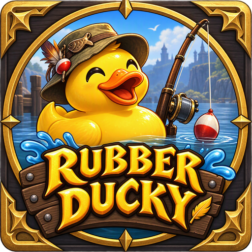

<h1 align="center">Rubber Ducky</h1>

<em>Your little fishing buddy</em> for <strong>World of Warcraft: Forever</strong>.

Rubber Ducky makes fishing easier on the ears and eyes. It hushes the world so the splash stands out, marks your bobber, eases the camera toward the water, and lets one button cast and reel in. Your catch lands straight in your bags with a splash banner. It's made for controller play, and it works just as well with mouse and keyboard.

## Features

- **Sound focus.** While your line is out, sound effects go up and music, ambience and dialog fade to a low mumble. It fades back as soon as you catch something or miss.
- **Bobber marker.** A rubber duck, or any of 24 bobber icons, floats above your bobber, with sparkles around it.
- **Fishing camera.** The camera eases in toward the water while you fish and back out when you're done.
- **One-button fishing.** With a pole equipped, one button casts and reels in. You can use Interact, or the left or right trigger on a controller. The button goes back to normal when you take the pole off or combat starts.
- **Auto loot.** Your catch goes straight to your bags, whichever button reeled it in. It doesn't change the game's own auto-loot setting.
- **Catch splash.** A banner slams onto the screen with what you caught, and each item's rarity colours its line. Misses get a splash too: "Missed!" when you reel in empty, and "Zzz..." when the cast runs out.
- **Pole swap.** Drag the Pole swap icon onto any action bar or crossbar slot. One press puts your fishing pole on, and the next puts back the weapon you had before. It works in combat.

## Install

1. Download the latest release.
2. Unzip it into `World of Warcraft/_forever_/Interface/AddOns/`, so that you have `AddOns/RubberDucky/RubberDucky.toc`.
3. Restart the game, or type `/reload`.

The first time you log in, a welcome screen helps you set things up. After that, type `/ducky` to open the settings. They're also under **Options > AddOns > Rubber Ducky**.

## Commands

| Command | What it does |
|---|---|
| `/ducky` | Open the settings |
| `/ducky icons` | Pick your bobber icon |
| `/ducky pole` | Swap between your fishing pole and your weapon (out of combat) |
| `/ducky test` | Preview the sparkle and bobber icon |
| `/ducky focus`, `sparkle`, `marker`, `camera`, `onekey` | Turn a feature on or off |
| `/ducky welcome` | Show the welcome screen again |
| `/ducky restore` | Put your sound and camera back right now |
| `/ducky help` | List the commands |

## Good to know

- **Bobber marker range.** Forever only soft-targets the bobber within about 10 yards. The marker and sparkles attach through that, so they don't show on longer casts. Reeling in with one button has the same limit.
- **No bite alert.** Forever doesn't tell addons when a fish bites, so Rubber Ducky can't alert you to one. Sound focus makes the splash as easy to hear as possible instead.
- **Other sound addons.** Another addon that changes music or ambience volume while you fish will fight with sound focus. Turn the sound option off in one of them.
- **Experimental camera notice.** The first time the camera eases in, the game may show a notice about experimental camera settings.

## Reporting a bug

Open the **Developer** page in the settings and switch on debug mode. A small console window appears. Do whatever causes the problem, then press **Copy** in the console and paste the text into your issue. For fishing problems, also tick **Event recorder** under Developer and fish once. Then send its log, which opens with **Show log** under Developer or `/ducky log`.

## Credits

The camera and one-button approaches follow [Improved Forever](https://www.curseforge.com/wow/addons/improved-forever) (MIT), which showed what Forever allows.

## License

MIT. See [LICENSE](LICENSE).
